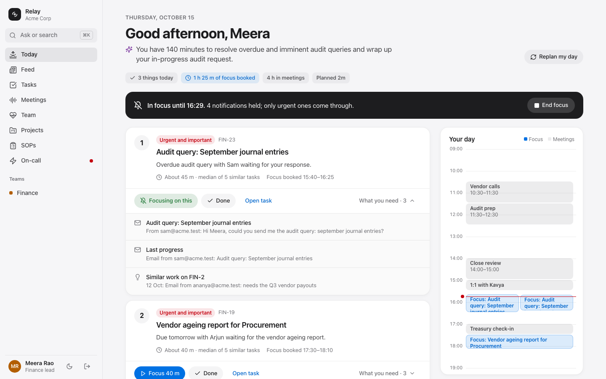
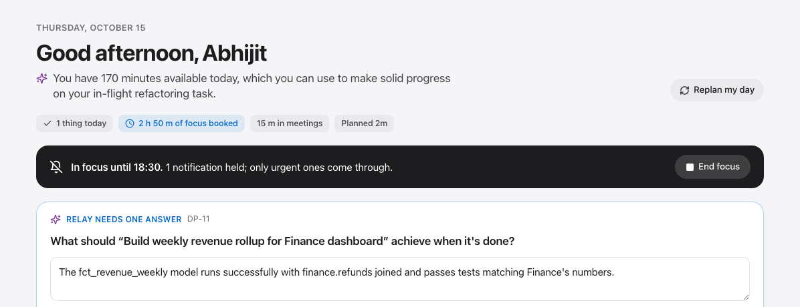
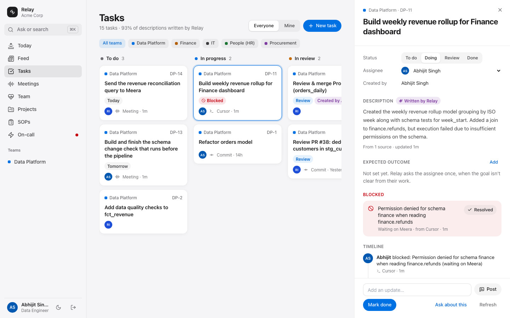
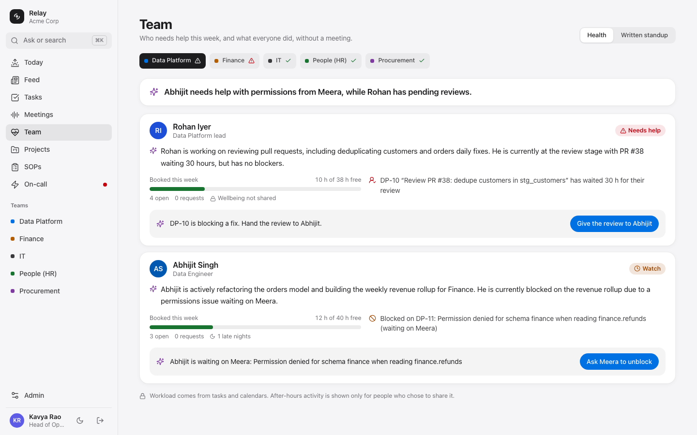
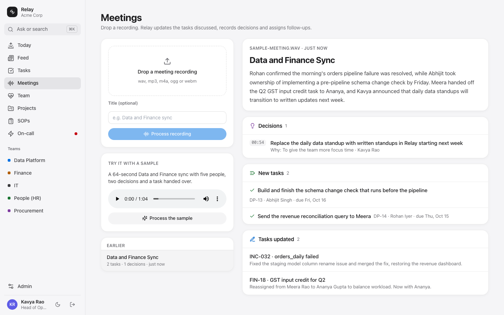
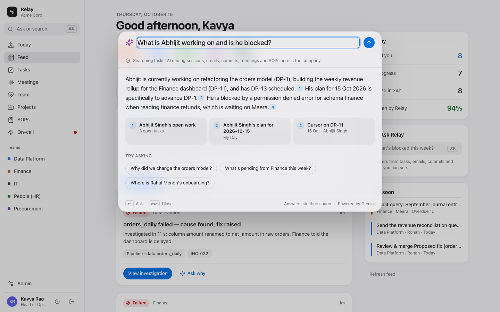
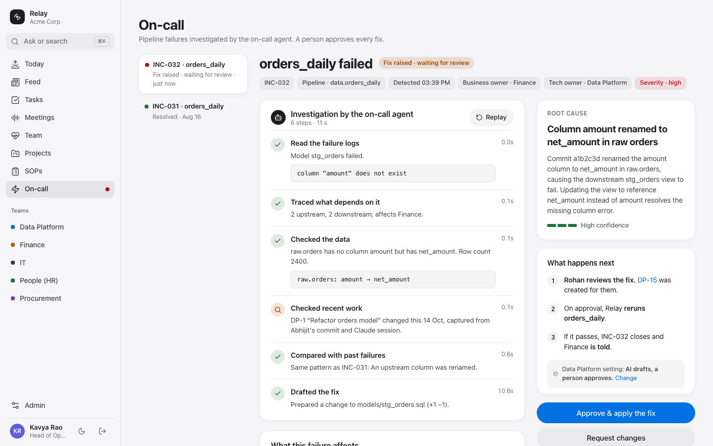
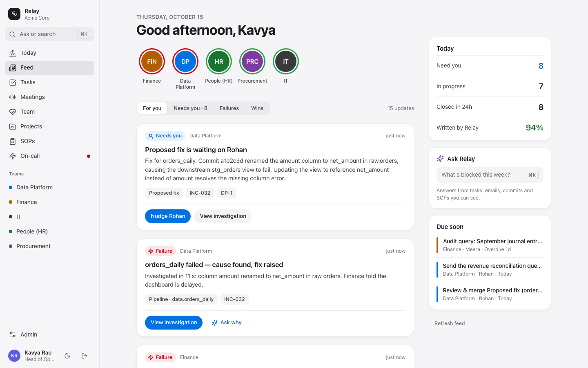
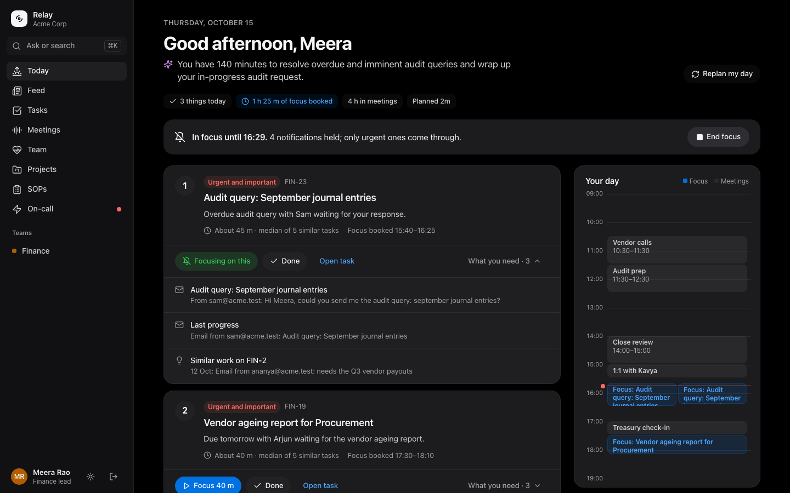
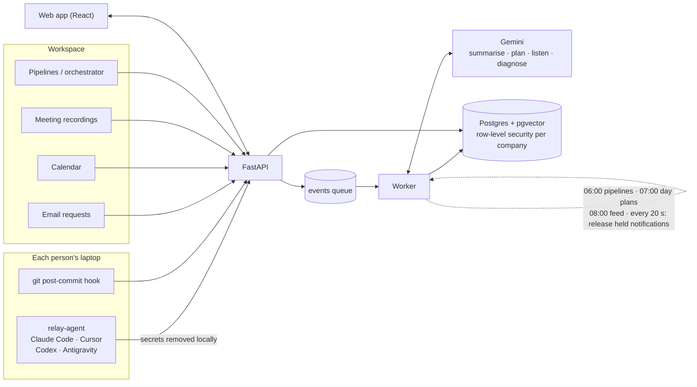

<div align="center">

# Relay

### The task tracker nobody has to update.

**An AI chief of staff for every team.** Relay reads the work people already do in Claude Code, Cursor, Codex,
Antigravity, git, email, calendars and meetings, and keeps the task list current on its own: what was done, what's
blocked, what "done" should look like. Every morning it plans each person's day and guards their focus. Managers see
progress and blockers without asking for a status update.

Google Cloud **AI Builder Cup** · theme: *Future of Work & Enterprise Productivity* · built with **Gemini**



</div>

---

## Contents

- [The problem](#the-problem)
- [What Relay does](#what-relay-does)
- [How it works](#how-it-works)
- [How Relay uses Gemini](#how-relay-uses-gemini)
- [Run it locally](#run-it-locally)
- [Connect your AI coding tools: relay-agent](#connect-your-ai-coding-tools-relay-agent)
- [Demo walkthrough](#demo-walkthrough)
- [Privacy and security](#privacy-and-security)
- [Project structure](#project-structure)
- [API](#api)
- [Tests](#tests)
- [Deploy to Google Cloud](#deploy-to-google-cloud)
- [Limitations and what's next](#limitations-and-whats-next)

---

## The problem

Task trackers only work if people update them, and nobody does. Engineers jump between Claude Code, Cursor and
Antigravity all day; the ticket still says "To do". Finance and HR handle a stream of ad-hoc email requests that never
reach any tracker. Managers fill the gap with status meetings, which take time from the people doing the work.

Research from Atlassian, Asian Efficiency and ProjectManager lists 24 productivity blockers between them. The ones all
three put first are about **attention and overload**, not missing information:

| Finding | Source |
|---|---|
| A typical office worker is interrupted every **11 minutes** and needs about **25 minutes** to get back to the task | UC Irvine study, cited by Atlassian |
| **65%** of senior managers say meetings keep them from finishing their own work; **64%** say meetings cost them deep thinking | HBR survey of 182 managers, cited by ProjectManager |
| **33%** of employees name technology problems as their top distraction | Udemy Workplace Distraction Report, cited by ProjectManager |

Every fix those articles suggest (prioritise with the Eisenhower matrix, pick three things a day, block focus time,
ask for feedback early) is manual discipline. Relay sees all the work, so it can do that planning *for* people.

## What Relay does

| Blocker | Relay |
|---|---|
| Nobody updates the tracker | **Self-updating tasks** from AI coding sessions (Claude Code, Cursor, Codex, Antigravity), git commits, email requests, calendar invites and meeting recordings |
| Managers can't see progress or blockers | **Blockers** pulled from the work itself, an **expected outcome** for every task, and an **AI summary per person** |
| Too many tasks, no idea where to start | **My Day**: top 3 by urgency and importance, estimated from similar finished tasks, booked into free time, with everything needed to start |
| Notifications and interruptions | **Focus Guard**: non-urgent pings wait until the focus block ends; Gemini decides what's urgent enough to come through |
| Meetings eat focus time | **Written standup** from logged work; **meeting recordings** become decisions, tasks and hand-overs |
| Overload, burnout, late feedback | **Team Health**: overload, after-hours work (only with consent), stuck reviews, missing early feedback, each with one suggested action |
| Searching emails, drives and chats | **Ask** (⌘K): answers with numbered citations, limited to what the asker can already see, from "why did we change X" to "what is everyone working on today" |
| Tool and pipeline failures | **On-call agent**: failure → investigation → fix → review task → rerun → closed |
| Processes nobody follows | **SOP builder**; projects whose steps tick themselves off from evidence; detection of outdated SOPs |

### Tasks that update themselves

A light agent on each laptop picks up AI coding sessions once they go quiet. Gemini reads each session, works out
which task it belongs to (or creates one), rewrites the description, records blockers and who they're waiting on, and
moves the status along. When the goal isn't clear from the work, Relay asks the person **once**, with a suggested
answer:





### Team Health and AI summaries for managers

One line per person, written by Gemini from their actual work: what they're working towards, how far along they are,
and what's in the way. Signals come with one action to apply in a tap: hand a stuck review to someone else, ask the
person being waited on to unblock, move a request off an overloaded colleague.



### Meetings → decisions and tasks

Drop a recording. Gemini listens, then records each decision with its reason and timestamp, creates tasks for the
owners with due dates, updates the tasks discussed, and hands work over when the meeting agreed to.



### Ask



### On-call agent

When a pipeline fails, the agent reads the error, traces what depends on it, checks the data, finds the change that
caused it (from the work log of whoever made it), recalls similar past incidents, drafts a one-line fix and creates a
review task for the owner. Approve, and Relay applies the fix, reruns the pipeline and closes the incident.



### The manager feed

A finite, ranked feed: things that need you first, then failures, stuck work, wins and decisions. Team "stories"
show each team's health at a glance. It ends with *You're all caught up*.



Light and dark appearance follow the system; the layout works down to phone width.



## How it works



- **API** (`backend/app/routes`): REST for the web app, `/ingest/*` for signals, `/webhooks/orchestrator` for
  pipeline results. Ingest returns immediately; the **worker** does the AI work from a Postgres-backed queue and
  re-queues jobs interrupted by a restart.
- **Postgres + pgvector** stores everything, including embeddings for search. Every table carries `org_id`, and the
  app connects as a non-superuser role so **row-level security** isolates companies even if application code has a
  bug.
- **Daily schedule** in the worker: 06:00 pipeline runs, 07:00 day plans, 08:00 feed. Kestra or any orchestrator can
  take over the pipelines instead: see [KESTRA.md](KESTRA.md).

## How Relay uses Gemini

| Job | Model | Thinking | Typical time |
|---|---|---|---|
| Read an AI coding session: summary, blockers, next steps, expected outcome | `gemini-3.8-flash` | low | 3–6 s |
| Plan a day (top 3, Eisenhower quadrant, reasons, estimates) | `gemini-3.8-flash` | low | 2–6 s |
| Listen to a meeting recording (audio in, structured JSON out) | `gemini-3.8-flash` | medium | ~25 s per minute of audio |
| Diagnose a pipeline failure; draft SOPs | `gemini-3.8-flash` | high | 10–30 s |
| "Does this continue task X, or is it new work?" · "Is this notification urgent?" | `gemini-3.5-flash-lite` | none | ~1 s |
| Team headlines and per-person summaries (one call per team, in parallel, cached 2 min) | `gemini-3.8-flash` | low | ~3 s |
| Ask: answers with citations from people's current work, tasks, sessions and logs | `gemini-3.8-flash` | low | 2–5 s |
| Search embeddings (batched, 768 dimensions) | `gemini-embedding-001` | — | <1 s |

Models were chosen by measuring what the key could use. `gemini-3.1-pro-preview` (what `gemini-pro-latest` points to)
took over three minutes per call even at low thinking, so it isn't used. Every model and thinking level is set in
`.env`. Calls retry on rate limits, and every AI step has an offline fallback, so the app runs without a key (meeting
capture excepted).

## Run it locally

Requires Docker.

```bash
git clone git@github.com:Abhijit-15022/hack2skill-aces.git && cd hack2skill-aces
cp .env.example .env          # add GEMINI_API_KEY (or set GOOGLE_CLOUD_PROJECT for Vertex AI)
docker compose up -d          # postgres, api, worker, web
```

| What | Where |
|---|---|
| Web app | http://localhost:3100 (`WEB_PORT` in `.env`) |
| API and interactive docs | http://localhost:8000/docs |
| Postgres | localhost:5433 |

Sign in with a demo account:

| Who | Email | Shows |
|---|---|---|
| Kavya Rao, Head of Operations (admin) | `kavya@acme.test` | Feed, Team Health, Admin → Demo |
| Meera Rao, Finance lead | `meera@acme.test` | A busy Today: overdue requests, back-to-back meetings, focus mode |
| Abhijit Singh, Data engineer | `abhijit@acme.test` | AI-session tasks, blockers, the expected-outcome question |
| Rohan Iyer, Data Platform lead | `rohan@acme.test` | A review waiting 30 hours |
| Grace Hopper, **Globex** | `grace@globex.test` | A second company that can't see Acme's data |

The seed creates three weeks of history for Acme Corp: tasks with real durations (for estimates), calendars, email
requests, an onboarding SOP with projects, and a past incident. `./scripts/reset-demo.sh` wipes everything and starts
fresh.

## Connect your AI coding tools: relay-agent

`agent/relay_agent.py` is a single file using only the Python standard library.

```bash
export RELAY_URL=http://localhost:8000 RELAY_INGEST_TOKEN=<from .env> RELAY_USER_EMAIL=you@company.com
python3 agent/relay_agent.py scan --since 2d   # list sessions it can see; sends nothing
python3 agent/relay_agent.py sync --since 1d   # send them now
python3 agent/relay_agent.py watch             # keep syncing every 5 minutes
python3 agent/relay_agent.py install           # macOS: start `watch` at login
```

| Tool | What it reads | What Relay gets |
|---|---|---|
| Claude Code | `~/.claude/projects/*/*.jsonl` | Full transcript, folder, git branch, files touched |
| Cursor | Cursor's `state.vscdb` (a copy, read-only) | Chat title, messages, timestamps, workspace |
| Codex | `~/.codex/sessions/**/*.jsonl` | Full transcript, folder |
| Antigravity | Antigravity's own per-conversation summaries in its app database | Title, workspace, timestamps, the agent's latest messages and task summary (full conversations are encrypted) |

Sessions are sent once they've been quiet for 5 minutes, and again only if they changed. Re-sending a session updates
the same task instead of creating a new one. More in [agent/README.md](agent/README.md).

Also available: a git post-commit hook (`./hooks/install.sh git <repo>`, which respects `core.hooksPath`) and a Claude
Code SessionEnd hook (`./hooks/install.sh claude`).

## Demo walkthrough

Admin → **Demo** has a button for each step. About four minutes end to end.

1. **Today, as Meera.** Her top 3 with reasons and estimates ("median of 5 similar tasks"), focus booked between her
   meetings, and *What you need* for each task.
2. **Focus Guard.** *Meera starts focusing, 5 pings arrive*: four wait, only the pipeline failure gets through.
3. **AI coding session.** *Abhijit's Cursor session hits a blocker*: Relay creates "Build weekly revenue rollup",
   marks it **Blocked** (waiting on Meera for access to `finance.refunds`), tells his lead, and asks Abhijit what
   "done" means, with a suggestion.
4. **Team, as Kavya.** AI summaries per person; Meera overloaded with late nights; Rohan's review stuck for 30 hours.
   Apply *Ask Meera to unblock* or *Give the review to Abhijit*. Switch to the *Written standup*.
5. **Meetings.** Process the 64-second sample: two decisions with timestamps, "schema change check" for Abhijit due
   Friday, and the GST request handed from Meera to Ananya.
6. **Break the pipeline.** The on-call agent finds the renamed column, links it to the task where it was renamed,
   recalls the earlier incident and drafts the fix. Approve → rerun → green.
7. **⌘K Ask.** "What are most people working on today?" · "What is Abhijit working on and is he blocked?"
8. **Isolation.** Sign in as Grace (Globex): none of Acme's data is visible.

## Privacy and security

- **Secrets never leave the laptop.** relay-agent removes API keys, tokens, passwords, private keys and credentials in
  URLs before sending; the server redacts again (including card, Aadhaar and PAN numbers) before any text reaches the AI.
- **Company isolation in the database.** Postgres row-level security on every table; the app has no way to bypass it
  for normal requests.
- **Ask only searches what the asker can already see**, filtered by team membership.
- **Wellbeing signals need consent.** Workload comes from tasks and calendars; after-hours activity is shown to
  managers only for people who opted in.
- **People stay in charge.** The on-call agent proposes fixes; a person approves. Each team chooses how much the AI may
  do on its own (suggest / draft for approval / act then tell). Every AI action is in the audit log.
- **Training.** On Vertex AI or a paid Gemini API plan, prompts aren't used to train Google's models.

## Project structure

```
backend/                 FastAPI app and worker (Python 3.11)
  app/routes/            org, work (tasks, projects, SOPs), ai (feed, Ask, on-call), people (My Day, focus,
                         Team Health, meetings), ingest (signals, webhooks, demo controls)
  app/services/          sessions (AI coding sessions), myday, focus, health, meetings, oncall, pipeline,
                         ingest, sop, feed, ask, matching, llm (Gemini), redact
  app/seed.py            Acme Corp and Globex demo data with three weeks of history
  tests/                 end-to-end tests against the running stack
web/                     React + Vite + Tailwind, Apple-style UI with shadcn-style components
agent/                   relay-agent: Claude Code, Cursor, Codex, Antigravity
hooks/                   git post-commit hook, Claude Code SessionEnd hook, installer
pipelines/               SQL models for the demo pipeline (templates/ holds the originals)
docs/                    screenshots; Kestra flows for teams that want an external orchestrator
deploy/gcp-vm.sh         one-command deploy to a Compute Engine VM
KESTRA.md                running pipelines from Kestra or another orchestrator
```

## API

Full interactive docs at `/docs`. The main routes:

| Area | Routes |
|---|---|
| Signals | `POST /ingest/session` (AI coding tools) · `/ingest/git` · `/ingest/email` · `/ingest/calendar` · `/ingest/claude` |
| Tasks | `GET/POST /tasks` · `PATCH /tasks/{id}` · `POST /tasks/{id}/outcome` · `POST /tasks/{id}/blockers/{id}/resolve` |
| My Day and focus | `GET /me/day` · `POST /me/day/plan` · `POST /me/focus` · `POST /me/focus/end` · `GET /me/notifications` · `GET /me/questions` |
| Managers | `GET /health/teams` · `POST /health/actions` · `GET /teams/{id}/standup` · `GET /feed` |
| Knowledge | `POST /ask` · `GET/POST /meetings` · `GET/POST /sops` · `GET/POST /projects` |
| On-call | `GET /incidents/{id}` · `POST /incidents/{id}/approve` · `POST /webhooks/orchestrator` |

Signal and webhook routes need the `X-Relay-Token` header; everything else uses the sign-in token.

## Tests

```bash
docker compose exec api pytest -q tests      # 15 end-to-end tests, real Gemini calls when a key is set
./scripts/reset-demo.sh                      # tests add data; reset afterwards
```

They cover company isolation, AI coding sessions (new task, blocker, outcome question, re-sent session),
email requests and replies, calendar evidence for SOP steps, SOP drafting, Ask, the feed, My Day, Focus Guard,
Team Health, the written standup and meeting capture.

## Deploy to Google Cloud

```bash
PROJECT=your-project-id ./deploy/gcp-vm.sh
```

Creates one `e2-standard-4` VM in `asia-south1`, installs Docker, copies the project and runs `docker compose up`,
then prints the URL. The VM's service account can call Vertex AI, so set `GOOGLE_CLOUD_PROJECT` in `.env` instead of
an API key.

Path to scale: Cloud SQL for Postgres with pgvector, API and worker on Cloud Run with Pub/Sub in place of the Postgres
queue, Identity Platform for Google Workspace sign-in, Cloud Storage for meeting recordings.

## Limitations and what's next

- **Calendars and email are simulated in the demo.** The ingest endpoints accept real events; connecting Google
  Calendar and Gmail needs per-user OAuth consent, which is next.
- **Antigravity full conversations are encrypted**, so relay-agent uses Antigravity's own summaries: less detail than
  the other tools. Codex support is written against its JSONL format but hasn't been tested on a machine with Codex.
- **Sign-in is by email for the demo**; production would use Google Workspace sign-in.
- **AI output varies.** Meeting analysis sometimes finds one of two decisions; task matching asks Gemini only when
  similarity is ambiguous; SOP evidence that the model disputes goes to a person instead of being dropped.
- Next: real Google Calendar and Gmail, a Chrome extension for Google Docs and Sheets activity, Slack and Google Chat
  digests, and a mobile view of Today.

---

<div align="center">

Built for the Google Cloud AI Builder Cup by **Abhijit Singh**, with Claude Code.

</div>
